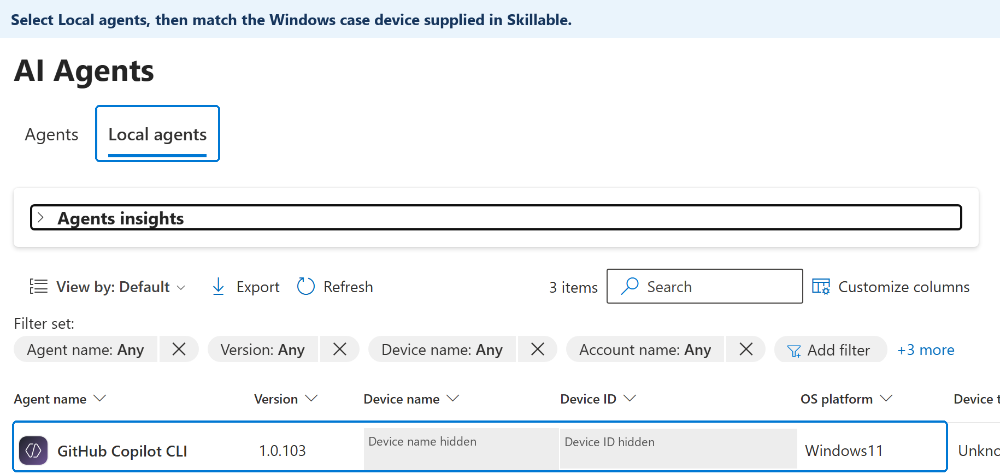
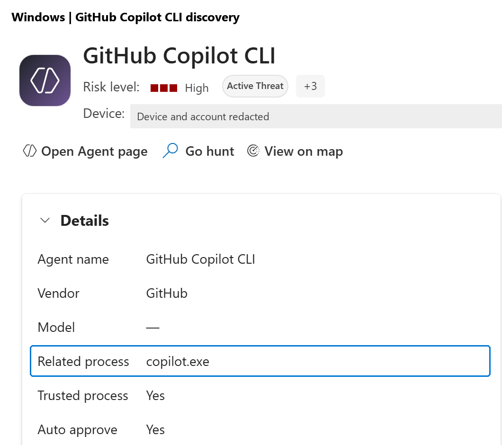
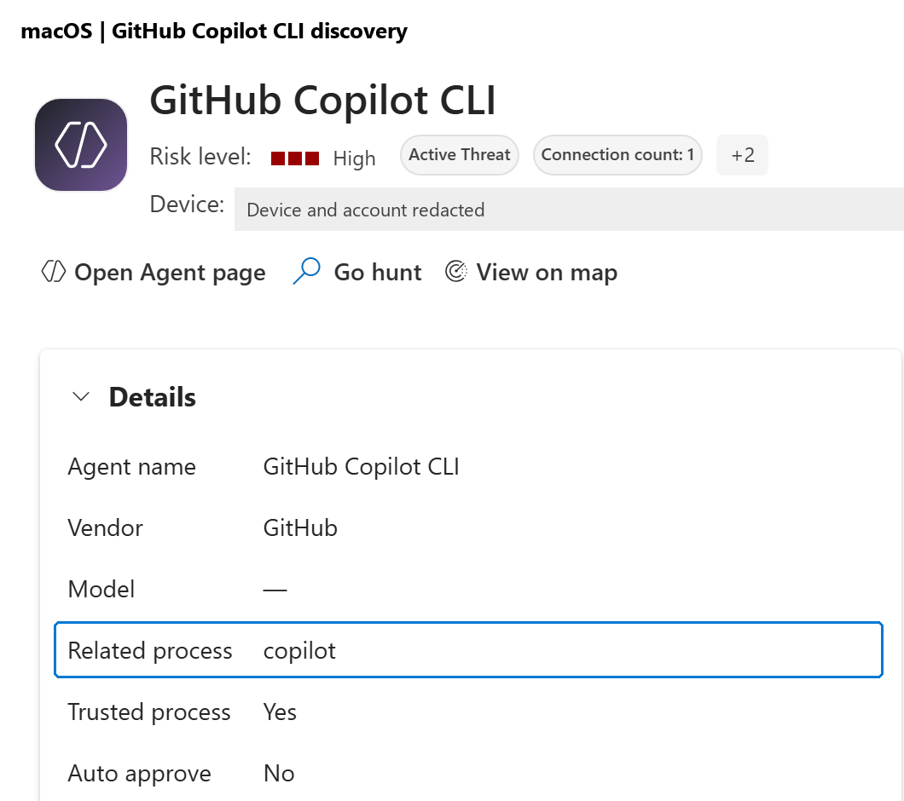

# Discover local AI agents in Microsoft Defender

## Sign in to the lab

1. Launch the assigned LAB683 environment in Skillable.
2. Select the **WIN1** link in the controlled lab instructions to open the Windows lab VM.
3. If Windows asks for Ctrl+Alt+Delete, use Skillable's **Ctrl+Alt+Delete** action.
4. Sign in with the Windows credentials supplied in Skillable. Do not use the Defender account for Windows.
5. Open **Microsoft Edge inside WIN1**, then go to [Microsoft Defender](https://security.microsoft.com).
6. Sign in with the assigned Defender username and Temporary Access Pass supplied in Skillable, not the Windows credentials. Use this browser for every Defender step, not the browser hosting Skillable.

Allow 5 minutes for sign-in. Credentials and prepared case links are deliberately kept in the controlled lab, not this public repository. If you cannot access the environment, contact the lab team; do not use a personal or production tenant or change account permissions.

**Read-only lab:** Inspect existing evidence without changing incidents, alerts, devices, or policies. Do not run captured commands, visit their destinations, or submit files for analysis.


## Discover local AI agents

> [!NOTE]
> **Foundation: Know which agents are present**
>
> Employees use local AI agents to help with their work. Before your security team can investigate activity involving those agents, it needs to know which agents are present and connect them to their devices, users, and processes. Build that context here, then use it in the two Windows investigations and, if time permits, the macOS bonus.

**Your task:** In this foundation exercise, identify an agent's host process, device, and account in the portal, then compare the inventory hunt with the portal. Each later case supplies its own device and process details. Allow 10 minutes.

### Why discovery matters to the investigations

For process-based discovery, Defender recognizes a supported agent when it observes the agent's process running on an onboarded device. In this lab, look for GitHub Copilot CLI and its related process. Instead of seeing only an executable, you can start an investigation knowing that it hosts an AI agent.

You will then follow that agent's process into the endpoint evidence: its child processes, commands, network connections, and associated alerts. Discovery answers **"What agent is this, and where does it run?"** The investigations answer **"What did this particular execution do, and how did Defender respond?"**

An inventory entry is not a single process execution. Defender groups a local agent by **agent type, device, and user**; several runs can belong to the same entry. In the later exercises, match the device, PID, and process creation time to identify the execution you are investigating.

There are two ways to start. Find an agent and look for suspicious activity on its device. Or open an endpoint alert and trace the process back to an agent. You'll use the agent-first route in scenario 1 and the macOS bonus, and the alert-first route in scenario 2.

Defender can discover **more than 50 local AI agent types**. These include command-line agents, desktop apps, agentic IDEs, and VS Code extensions. Check the [AI agent support matrix](https://learn.microsoft.com/en-us/defender-endpoint/ai-agent-support-matrix#ai-agent-discovery-support) for supported platforms and features. Discovery and runtime protection each have their own support list.

Defender finds some VS Code agents through checks for installed extensions. Use process and prompt-call events, where available, to explore what an agent did. See [how local agent discovery works](https://learn.microsoft.com/en-us/defender-endpoint/local-agent-discovery-overview#local-ai-agent-discovery-on-endpoints).

## 1. Inspect the discovered agents

**The hands-on lab starts here.**

Try the investigation steps and questions on your own first. Expand **Show findings and explanation** whenever you want help or want to check your interpretation. No notes or written answers are required.

**Question: How does Defender identify the agent behind a process on a device?**

1. In Defender, expand **Assets** and select **AI agents**. Select **Show navigation** first if the navigation is collapsed.
2. Select the **Local agents** tab, shown below. The blue outlines highlight the tab and the Windows entry used next. Device identifiers are hidden in these public screenshots; match the values supplied in Skillable.



3. Scroll past **Agents insights** to the agent list. Find **GitHub Copilot CLI** with **Windows11** in **OS platform** and **Device ID** matching the **Windows XPIA device ID supplied in Skillable**. Select that row's **Device ID** value to open the details flyout. Do not select the other Windows entry used for the misalignment case.
4. In the flyout, read **Related process**. The device and user appear below the agent name. Scroll within the flyout to inspect **Trusted process** and **Auto approve**, if shown. These are configuration details, not a record of what ran.
5. Select **X** in the flyout to close it. In the same list, find **GitHub Copilot CLI** with **macOS** in **OS platform** and **Device ID** matching the **macOS MCP device ID supplied in Skillable**. Select its **Device ID** value. This is a brief inventory comparison, not the bonus investigation.
6. Read **Related process** and compare the available configuration fields with the Windows entry. Close this flyout with **X**. Leave the inventory open; the next section opens Advanced hunting.

<details>
<summary>Show findings and explanation</summary>

Defender associates GitHub Copilot CLI with `copilot.exe` on Windows and `copilot` on macOS. The device and account distinguish agent profiles with the same name.

These screenshots highlight **Related process**. Device and account information is hidden.

**Windows:**



**macOS:**



Auto-approval, trust, and MCP fields describe configuration. They do not prove that an agent used a setting or ran a tool. Available fields and values can differ between profiles. Process and alert events show what ran.

</details>

If you can't open the agent list, continue to **2. Hunt: compare agent inventory** below.

## 2. Hunt: compare agent inventory

**Question: Can you find the same instances in the hunting data?**

1. Select **Advanced hunting** in the Defender navigation. If it isn't pinned, expand **Investigation & response** > **Hunting**, then select **Advanced hunting**.
2. Dismiss any introductory tour with **Not now**. Select **Create new** > **Query in editor** to open a fresh query tab.
3. Copy the complete query below. Click inside the query editor and press **Ctrl+A** to replace any existing text. Right-click inside the editor and select **Paste**, then select **Run query**. Use the editor inside WIN1, not the browser hosting Skillable.

```kusto
AgentsInfo
| where Timestamp > ago(30d)
| where Platform == "LocalAgents"
| summarize arg_max(Timestamp, *) by AgentId
| where LifecycleStatus !in ("Deleted", "Uninstalled")
| extend Local = RawAgentInfo.localAgentMetadata
| project Timestamp, AgentId, Name, SourceAgentId, Version,
    DeviceName = tostring(Local.deviceName),
    RelatedProcess = tostring(Local.relatedProcess),
    AutoApprove = tostring(Local.autoApprove),
    TrustedProcess = tostring(Local.trustedProcess)
| order by DeviceName asc, Name asc
| take 50
```

**About the results:** The query summarizes the data to one row per agent profile (`AgentId`), using the latest record from the past 30 days. A profile is one agent on one device for one user. The same agent name can appear in several rows.

4. Under **Results**, find a **GitHub Copilot CLI** row. Select its **Timestamp** value to open **Inspect record**. If this only selects the row, double-click the same value. Do not select the checkbox or a linked device name.
5. In that pane, scroll to **All details**. Read `Name`, `DeviceName`, `RelatedProcess`, and `Timestamp`. Expand **All details** if it is collapsed.
6. Close **Inspect record** with its **X**. Select **Assets** > **AI agents** > **Local agents** to return to the portal inventory. Open the Windows or macOS row as in section 1 and compare its agent name, device, and related process with the result. Close the flyout when finished.

<details>
<summary>Show findings and explanation</summary>

For GitHub Copilot CLI, look for `copilot.exe` on Windows or `copilot` on macOS. Recognizing the host process helps you find the agent in a process tree.

`Timestamp` is the latest inventory observation returned for that profile, not the start of a specific process. Each case supplies its device ID, PID, and process creation time so you can match the historical execution without carrying details forward.

</details>

<details>
<summary>If the inventory results reach 50 rows</summary>

Return to **Advanced hunting** and select the query tab you just ran. Insert `| where Name == "GitHub Copilot CLI"` immediately before `| order by DeviceName asc, Name asc`, then select **Run query** again. This limits the results to the agent used in this lab without changing the latest-record summary.

</details>

## 3. Connect discovery to investigation

### Optional reflection: Check your findings

There are no new portal actions on this page. Think through these questions, then expand the findings if useful. No notes or written answers are required.

1. Which host process did Defender associate with GitHub Copilot CLI?
2. Why do the device and account matter when identifying an agent? What additional details identify a particular execution?
3. How will you use the inventory details to find the agent's process events in the next investigations?

<details>
<summary>Show findings and explanation</summary>

GitHub Copilot CLI uses `copilot.exe` on Windows and `copilot` on macOS. Defender makes the agent recognizable as an asset associated with its device, user, and host process. The portal and `AgentsInfo` show that discovery context.

The device and account distinguish agent profiles. To identify a particular execution, match the device, PID, and process creation time supplied in the case. A process name alone is not enough.

Find the agent's host process in the process tree or timeline, then follow its children, commands, network events, and alerts. Settings describe how the agent is set up. Process and alert events show what it did.

</details>

Continue to the [Windows prompt-injection scenario](01-windows-xpia.md).
