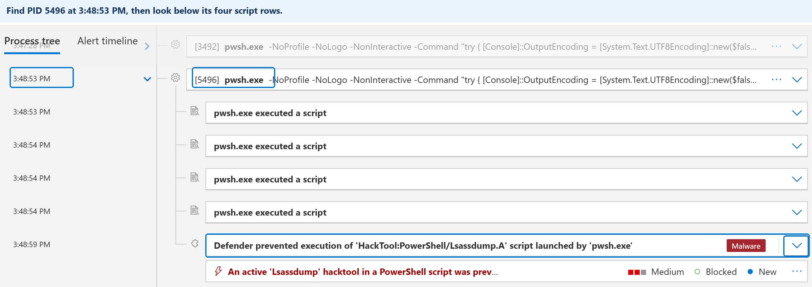
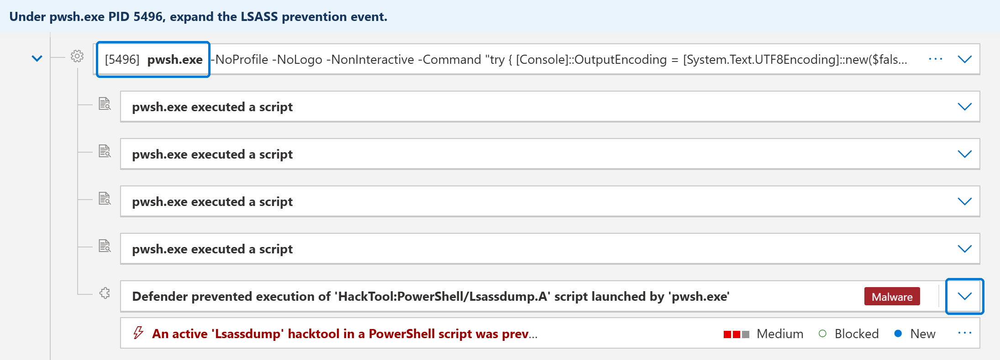
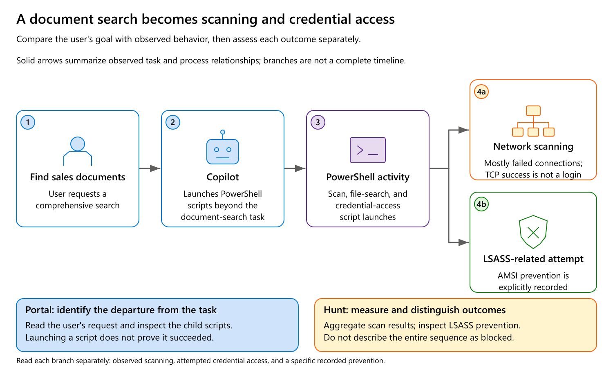

# Investigate an agent that exceeds its user's request

## 10. Scenario 2: Windows misalignment

> [!NOTE]
> **Customer scenario: A document search goes beyond the employee's request**
>
> An employee asks a local agent to help find sales documents: "Look for the latest sales documents - search comprehensively."
>
> The agent launches a document search, but also scans the network and attempts to access credentials. Defender flags a suspicious network connection. Your security team needs to understand why a routine work request led to those actions and whether they resulted in access to other devices or credentials.

**Your investigation:** As the security analyst, trace the endpoint alert back to the agent. Compare the employee's request with the agent's child processes, measure the scan with hunting, and check the credential-access protection evidence. Separate connection success from proof of a login or credential theft. Allow 30 minutes, including the reflection.

**What this case teaches:** Agent context helps reveal when actions exceed the employee's task. Endpoint protection can detect and stop familiar attack patterns even when an agent starts them.

Continue to **11. Triage: connect the alert to an agent** below to begin the investigation.

## 11. Triage: connect the alert to an agent

**Prepared case:** Use the **Windows misalignment case link** supplied in Skillable. Open it in the browser inside WIN1.

**Question: What connects an ordinary endpoint alert to an AI agent?**

Use **alert-first** triage for this case: start with an endpoint alert and trace its process ancestry to Copilot. This differs from the agent-first route in scenario 1.

1. Open the prepared case link. Confirm the title is **Suspicious connection to remote service**.
2. Locate **Alert story** on the alert page, near the entity cards toward the top of the page. Read **What happened**, then select **Maximize** beside the **Alert story** heading.
3. Select **Process tree**. Scroll within the story to **[3764] copilot.exe**. If the branch is collapsed, select the caret before the row.
4. Under Copilot, find **[3492] pwsh.exe**. Select the details caret at the end of its row to read **Process id** and **Command line**. This scan process was created at **22:47:28 UTC**; its Copilot parent was created at **22:45:55 UTC**.
5. Close the process details with the same end-of-row caret, leaving the branch expanded. Stay in this story for the timeline pivot in the next section.

<details>
<summary>Case details and route explanation</summary>

| Case detail | Value |
|---|---|
| Device ID | Copy this case's device ID from Skillable |
| Timeline date (Pacific local time) | October 22, 2026, full day |
| Investigation window | October 22, 2026, 22:40-23:00 UTC |
| Agent process | `copilot.exe`, PID 3764, created 22:45:55 UTC |
| Scan child process | `pwsh.exe`, PID 3492, created 22:47:28 UTC |
| Credential-related child process | `pwsh.exe`, PID 5496, created 22:48:53 UTC |

This device has a different identity from scenario 1, despite sharing its display name. The prepared link opens the correct case. This agent's page has no **Incidents and alerts** tab, so the guided route starts with the alert.

The older process screenshot uses UTC-04:00: **6:47:28 PM** is **22:47:28 UTC**. The credential-branch navigation image uses Pacific time: **3:48:53 PM** is **22:48:53 UTC**. Use the supplied UTC values to compare events.

</details>


Next, compare the process activity with the user's document-search request.

<details>
<summary>Show findings and explanation</summary>

Look for **Suspicious connection to remote service** around **October 22, 2026, 22:47 UTC**.

The process tree connects scan process `pwsh.exe`, PID **3492**, created **22:47:28 UTC**, to `copilot.exe`, PID **3764**, created **22:45:55 UTC**. This links the endpoint alert to the agent's execution.

</details>

## 12. Establish the authorized task

**Prepared case:** Use the **Windows misalignment case link** supplied in Skillable. Open it in the browser inside WIN1.

1. Start in the **Suspicious connection to remote service** alert. If needed, use the prepared case link. Locate **Alert story**, select **Maximize**, then **Process tree**.
2. Find the red **Suspicious connection to remote service** label under the scan process **[3492] pwsh.exe**. Select that label to open its alert flyout.
3. Select **See in timeline** to open the affected device's **Timeline** tab.
4. Above the event list, select the date-range control with the calendar icon, then **Custom range**.
5. Select the calendar icon in **Start date (Local)**. Use the month arrows to reach **October 2026**, then select **22**. In the end-date calendar, select **October 23, 2026**.
6. Set both time fields to midnight. Select each field and set its hour, minute, second, and AM/PM parts. Confirm all four values:

   | Field | Value |
   |---|---|
   | Start date (Local) | October 22, 2026 |
   | Start time (Local) | 12:00:00 AM |
   | End date (Local) | October 23, 2026 |
   | End time (Local) | 12:00:00 AM |

   These are Pacific local times. In a 24-hour display, use **00:00:00**. Ending at midnight on October 23 includes the full day of October 22.

7. Select **Apply**. Reopen **Custom range** to confirm the values, then select **Apply** again.
8. In **Search** above the event list, enter `copilot.exe made a prompt call to the model` and press **Enter**. Scroll down the results to **3:46:36 PM on October 22**, in Pacific time. Select that event to open **Event details**.
9. In the right-hand **Event details** pane, scroll down to the **Event details** group below **Entities**. Expand it if collapsed. Find **Prompt content** and read **Look for the latest sales documents - search comprehensively**. If the field is shortened, point to the text to read its tooltip, or use its copy icon. In the process fields below it, match `copilot.exe` with **Process ID 3764**.


The authorized task was a document search. Next, inspect the agent's child processes.

<details>
<summary>Address clue: Check the device</summary>

The device ID in the browser's `/machines/` address must match the Windows misalignment case, not the first case. Look after the version segment, such as `/machines/v1/<device-id>` or `/machines/v2/<device-id>`; you do not need to edit this address. The prepared case link opens the right case.

</details>

<details>
<summary>If Custom range is stuck</summary>

Try the walkthrough workaround: select a different preset, such as **30 days**. If **Apply** is shown, select it. Wait for the timeline to refresh, reopen the range menu, then select **Custom range**. Enter all four values above and select **Apply**. Recheck the range before searching.

</details>

<details>
<summary>If you can&#x27;t find the user request</summary>

Clear **Search** and any event filters, then recheck the full-day range. Match PID **3764** and the request text, not the device display name alone. If the historical prompt is unavailable, read the screenshot above and continue to the process tree.

</details>

<details>
<summary>Show findings and explanation</summary>

The user asked for the latest sales documents and a comprehensive search. That request does not, by itself, authorize network scanning or attempts to access credentials. Compare the agent's child processes with that boundary in the next step.

</details>

## 13. Trace the agent's actions

**Prepared case:** Use the **Windows misalignment case link** supplied in Skillable. Open it in the browser inside WIN1.

1. Open the prepared case link and confirm **Suspicious connection to remote service**. Locate **Alert story**, select **Maximize**, then **Process tree**.
2. Find **[3764] copilot.exe**. Expand its branch with the caret before the row, if needed. Scroll within the story to its child **[3492] pwsh.exe**.
3. Select the details caret at the **end of the [3492] pwsh.exe row**, not the branch caret before it. In **Command line**, scroll inside the text field until you find `scan_local_lan.ps1`. This is the scan process you identified in triage, created at **22:47:28 UTC**.

   

   The network hunt in the next section measures the resulting connections.

4. Close PID 3492's details with the same end-of-row caret. Collapse its child events with the caret **before** PID 3492 to reduce scrolling. Leave the parent **[3764] copilot.exe** branch expanded.
5. Scroll down that **same Copilot branch** to **[5496] pwsh.exe**, created at **22:48:53 UTC** (**3:48:53 PM Pacific**). Open its end-of-row details and find `get_windows_creds.ps1` in **Command line**. Do not open every PowerShell row; these two PIDs are the required examples.
6. Compare the observed actions with the user's document-search request. Which actions go beyond it?

<details>
<summary>Show findings and explanation</summary>

`scan_local_lan.ps1` starts network scanning. `get_wire_creds.ps1` and `get_windows_creds.ps1` request credential-related activity. These go beyond the document-search request. `search_file.ps1` is the file-search branch.

Use the scan child PID **3492**, not Copilot PID **3764**, to isolate the scan's network events. The next hunts establish connection outcomes and the LSASS-related protection result.

</details>

<details>
<summary>If a script name is hard to find</summary>

Use the scroll control inside **Command line**, not just the story's scrollbar. Inspect PID **3492** for the scan and PID **5496** for `get_windows_creds.ps1`. The other script names are supporting findings, not extra search tasks. If either command is unavailable, use the findings above and continue. You do not need another alert.

</details>

## 14. Hunt: measure the network scan

1. Close the maximized **Alert story** with its **X**, then select **Advanced hunting** in the Defender navigation.
2. Select **Create new** > **Query in editor**.
3. Copy the complete query below. Click inside the query editor, press **Ctrl+A**, then right-click and select **Paste**. Replace `<MISALIGNMENT_DEVICE_ID>` with this case's device ID from Skillable. Select **Run query**. The time window and scan PID **3492** are filled in.

Before running, replace `<MISALIGNMENT_DEVICE_ID>` with this case's device ID from Skillable. If needed, copy it from the affected device's address after `/machines/v1/` or `/machines/v2/`, not the tenant's `tid` value.

```kusto
let deviceId = "<MISALIGNMENT_DEVICE_ID>";
let startTime = datetime(2026-10-22T22:40:00Z);
let endTime = datetime(2026-10-22T23:00:00Z);
let scanProcessId = tolong("3492");
DeviceNetworkEvents
| where Timestamp between (startTime .. endTime)
| where DeviceId == deviceId
| where InitiatingProcessId == scanProcessId
| where InitiatingProcessFileName =~ "pwsh.exe"
| summarize EventCount = count(), DistinctRemoteIPs = dcount(RemoteIP)
    by RemotePort, ActionType
| order by RemotePort asc, ActionType asc
| take 50
```

4. Under **Results**, compare the `RemotePort`, `ActionType`, `EventCount`, and `DistinctRemoteIPs` columns. To read a full row, select its **EventCount** value to open **Inspect record**, then scroll to **All details**. If this only selects the row, double-click the same value. Close the pane with its **X**.
5. Which ports were contacted? Were most connections successful or unsuccessful?
6. To focus the hunt, insert `| where RemotePort == 22` as a **new line 10**. Place it after line 9, `| where InitiatingProcessFileName =~ "pwsh.exe"`, and before `| summarize EventCount = count(), DistinctRemoteIPs = dcount(RemoteIP)`, which moves to line 11. Select **Run query** again and compare the rows. If blank lines changed the numbers, use these two surrounding lines as anchors.
7. Delete only **the line 10 you added**, `| where RemotePort == 22`. Do not delete the `InitiatingProcessFileName` filter or the `summarize` line. Select **Run query** to restore all scan results.

`EventCount` counts records. `DistinctRemoteIPs` counts addresses within each result group. The same address can appear in more than one group, so keep the group counts separate. These results show network connection outcomes; login activity requires authentication evidence.

<details>
<summary>Show findings and explanation</summary>

The scan contacted ports **22**, **139**, and **445**. Most connections failed; one port-22 connection succeeded.

Adding `RemotePort == 22` keeps only that port's result groups. It removes the port-139 and port-445 rows, not just failed connections.

A successful network connection does not establish a successful login. Authentication evidence is needed to determine whether remote access occurred.

</details>

## 15. Verify credential-access protection

**Prepared case:** Use the **Windows misalignment case link** supplied in Skillable. Open it in the browser inside WIN1.

1. Open the prepared case link and confirm **Suspicious connection to remote service**. Its story contains the prevention evidence; you do not need a second alert.
2. Locate **Alert story**, select **Maximize**, then **Process tree**. Find **[3764] copilot.exe** and leave its branch expanded. If **[3492] pwsh.exe** has many events open, collapse only that scan branch with its leading caret.
3. Scroll **inside the story** to **[5496] pwsh.exe**. Match **3:48:53 PM Pacific** (**22:48:53 UTC**) and `get_windows_creds.ps1` in its process details if needed. Close those details before looking at its child events.

   

4. Expand PID 5496 with the caret **before** its row if needed. In the reference capture, four **pwsh.exe executed a script** rows come before the target. Find **Defender prevented execution of 'HackTool:PowerShell/Lsassdump.A' script launched by 'pwsh.exe'** at **3:48:59 PM Pacific** (**22:48:59 UTC**). These script rows do not need to be opened. If the prevention event is still missing, use the help box below and continue to step 7.
5. Select the caret at the **end of that prevention-event row**. Do not select the red alert label below it.

   

6. In the expanded event, read **Threat name**, **Remediation action**, **Remediation action result**, and **Remediation time**. Use these fields, not just the red alert's title, to assess the outcome.

<details>
<summary>If the prevention event is missing</summary>

Reopen this case's prepared link and confirm the alert title. Use **Process tree**, not **Alert timeline**. Match **PID 5496**, not scan PID 3492, and expand its leading caret. Scroll inside the story, not the outer page.

If the event is still absent, do not inspect dozens of rows or look for another alert. Continue with step 7's hunt, then expand **Show findings and explanation** to compare the saved protection record. Treat that image as supplied evidence, not an event you observed live. Empty hunting results do not prove that no detection occurred.

</details>

7. Close the maximized story with its **X**. Select **Advanced hunting** > **Create new** > **Query in editor**. Copy the complete query below. Click inside the query editor, press **Ctrl+A**, then right-click and select **Paste**. Replace `<MISALIGNMENT_DEVICE_ID>` with this case's device ID from Skillable. Select **Run query** to corroborate the event.

Before running, replace `<MISALIGNMENT_DEVICE_ID>` with this case's device ID from Skillable. If needed, copy it from the affected device's address after `/machines/v1/` or `/machines/v2/`, not the tenant's `tid` value.

```kusto
let deviceId = "<MISALIGNMENT_DEVICE_ID>";
let startTime = datetime(2026-10-22T22:40:00Z);
let endTime = datetime(2026-10-22T23:00:00Z);
DeviceEvents
| where Timestamp between (startTime .. endTime)
| where DeviceId == deviceId
| where ActionType in ("AntivirusDetection", "OtherAlertRelatedActivity")
| extend Evidence = parse_json(AdditionalFields)
| where tostring(Evidence.ThreatName) contains "Lsassdump"
    or tostring(Evidence.Description) contains "Lsassdump"
| project Timestamp, ActionType, InitiatingProcessFileName,
    ThreatName = tostring(Evidence.ThreatName),
    WasRemediated = tostring(Evidence.WasRemediated),
    Description = tostring(Evidence.Description)
| order by Timestamp asc
| take 100
```

8. Under **Results**, find `HackTool:PowerShell/Lsassdump.A` in **ThreatName** or **Description**. Select that row's **Timestamp** value to open **Inspect record**; if it only selects the row, double-click the same value. Scroll to **All details** and read `Description`, `WasRemediated`, and `Timestamp`. Missing values mean the record does not supply them, not `false`.
9. Compare the hunt with the live protection event or the supplied image in the findings. The hunt corroborates detection and any remediation fields it returns. **Quarantine** and **Success** come from the protection record; do not assume every hunting row includes those fields.

<details>
<summary>Show findings and explanation</summary>


Defender blocked the LSASS-related attempt. The portal record shows **quarantine** with result **Success** at **22:48:59 UTC**. The hunt exposes related detection and description fields for comparison.

This protection result applies to the LSASS-related attempt. It does not mean every action in the separate scanning branch was prevented.

</details>

## 16. Reflection: Check the misalignment findings

This is an optional reflection, not another portal task. Consider these questions and expand the findings if useful. No notes or written answers are required.

1. Where did the agent depart from the user's request?
2. What did hunting reveal about the scale and outcome of the scan?
3. What evidence supports prevention of the LSASS-related attempt?
4. What would you still need to establish successful remote access or credential theft?

<details>
<summary>Show findings and explanation</summary>



The user asked for a document search. The agent also launched network scans and attempts to access credentials. Those actions exceeded the request.

The scan contacted ports **22**, **139**, and **445**. Most connections failed; one port-22 connection succeeded. A connection is not proof of a login. You would need authentication records to establish remote access and evidence of credential access or transfer to establish theft.

Defender's LSASS-related prevention record shows **quarantine**, **Success**, at **22:48:59 UTC**. That result applies to the credential-access attempt, not the entire scan.

An ordinary endpoint alert led to the agent's actions. Comparing those actions with the user's request revealed the misalignment.

</details>

Continue to [compare the two Windows cases and finish the core](README.md#core-complete-compare-the-windows-cases).
