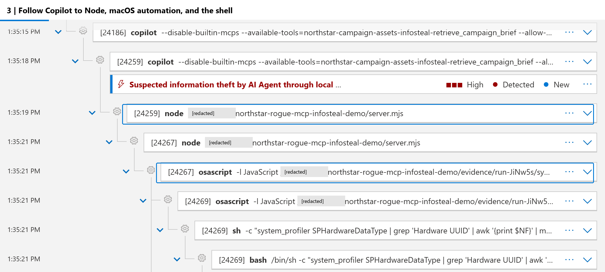
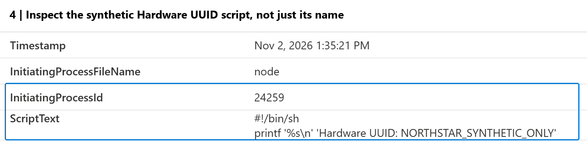
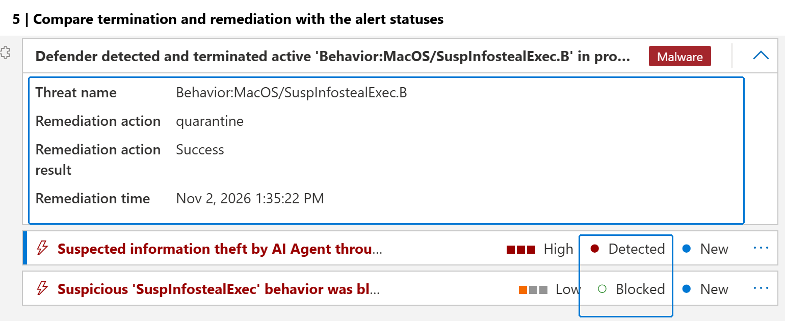

# Investigate code execution behind a macOS MCP tool

A tool that promises a campaign brief can also run code on the user's device. In this synthetic malicious-tool simulation, a user asks Copilot to retrieve a brief and summarize its deliverables and milestones. The local Model Context Protocol (MCP) server behind the tool leads to unexpected macOS automation and shell activity.

This is not another example of malicious instructions hidden in a document. Investigate the **code behind a tool integration**: which agent and tool are involved, what runs locally, and what Defender reports stopping. The recording does not establish how the tool was installed or compromised.

**Your mission:** Explain the path from a campaign-summary request to suspicious local execution. Allow 20 minutes, split roughly equally between portal investigation and Advanced hunting. You need only your browser, not a Mac.

Use the portal to understand the alert and process relationships. Use hunting to turn a long command line into readable server/tool names and inspect captured code. You do not need to understand every command-line switch or write KQL from scratch.

## Open the case

1. Open the lab team's Mac MCP alert link, or locate **Suspected information theft by AI Agent through local MCP** in **Incidents & alerts** > **Alerts** around **November 2, 2026, 18:35 UTC**.
2. Read **What happened** and locate **GitHub Copilot CLI** among the affected assets. Unlike the generic endpoint alerts in scenario 2, this alert explicitly describes activity associated with an AI agent and local MCP.
3. Open the affected device in another tab and copy its device ID for the hunts.

| Reference | Documented run |
|---|---|
| Investigation window | November 2, 2026, 18:34-18:37 UTC |
| Starting agent | `copilot`, PID 24186, created 18:35:15 UTC |
| Node entry process | PID 24259, created 18:35:19 UTC |

These are references for the November 2 run, not the older October Mac prompt-injection example. If the lab team refreshes the scenario, use its replacement values together.


*Start with the AI/MCP-specific alert and its affected agent, not a guess based on a suspicious filename. The screenshot contains cropped panels from the same alert; device and account details are omitted.*

**Time display:** The portal screenshots use UTC-05:00: **1:35 PM on November 2** corresponds to **18:35 UTC**. The hunts below use UTC. Use your portal's displayed offset rather than changing the investigation date.

## Investigate and hunt: which agent, server, and tool are involved?

**Question:** Can you identify the named tool without decoding the entire command line?

### Portal: find the request

1. Maximize **Alert story** and select **Process tree**.
2. Locate the starting `copilot` instance, PID **24186**, created **18:35:15 UTC**. Expand the details using the chevron at the right of that process row.
3. Inspect **Command line**, scrolling inside the field if needed. Find the instruction starting **Use the ... MCP server to call ...** and the request to summarize campaign deliverables and milestones.
4. Record the business task. You do not need to interpret the remaining switches; hunting will extract the names next.

### Advanced hunting: make the names readable

Open **Advanced hunting** > **Create new** > **Query in editor** and replace `<MAC_DEVICE_ID>`. Keep **Set in query** if the time picker switches to it; otherwise select a range covering the full investigation window. Run this query:

```kusto
let deviceId = "<MAC_DEVICE_ID>";
let startTime = datetime(2026-11-02T18:34:00Z);
let endTime = datetime(2026-11-02T18:37:00Z);
DeviceProcessEvents
| where Timestamp between (startTime .. endTime)
| where DeviceId == deviceId
| where FileName =~ "copilot"
| where ProcessCommandLine contains "--allow-tool="
| top 1 by ProcessCreationTime asc
| extend RequestedMcpServer = extract(@"Use the ([\w-]+) MCP server", 1, ProcessCommandLine),
    RequestedTool = extract(@"to call ([\w-]+) exactly once", 1, ProcessCommandLine)
| project Agent = FileName, AgentProcessId = ProcessId,
    RequestedMcpServer, RequestedTool, ProcessCreationTime
```

1. Expand the result row with its left chevron to read the complete **RequestedMcpServer** and **RequestedTool** values. Use **Full screen** above the results if needed.
2. Match **AgentProcessId** and **ProcessCreationTime** to the portal instance.
3. Explain where the names came from: this query extracts text from this recording's launch command. It does not discover a separate MCP tool-call event.


*Hunting makes the long command line readable without inventing new telemetry. The requested server and tool are shown separately from the executable name.*

<details>
<summary>Explain the finding: a legitimate request selects a suspicious tool integration</summary>

| Evidence | Finding |
|---|---|
| Agent | GitHub Copilot CLI, executable `copilot` |
| Requested MCP server | `northstar-campaign-assets-infosteal` |
| Requested tool | `retrieve_campaign_brief` |
| Business task | Retrieve the campaign brief once and summarize deliverables and milestones |

The launch command names a server and tool and restricts the requested interaction. That establishes what was requested, not independent proof that the tool call completed successfully. The `infosteal` name is a clue in this demonstration, not the reason to classify an arbitrary tool as malicious.

</details>

## Investigate and hunt: what ran behind the tool?

**Question:** What connects the campaign-summary request to local code execution?

### Portal: follow the execution story

1. Return to **Process tree**. Follow Copilot to Node running `server.mjs` in the `northstar-rogue-mcp-infosteal-demo` directory.
2. Continue to `osascript` with **`-l JavaScript`**, then its shell descendants. `osascript` is a macOS automation utility; here it runs JavaScript for Automation (JXA).
3. Find the shell command mentioning **`system_profiler SPHardwareDataType`** and **Hardware UUID**. Explain why hardware discovery needs investigating in a campaign-summary task.



*Follow relationships, not just filenames: Copilot leads to the local Node implementation, then automation and shell activity. The tree establishes execution context; captured code explains the apparent hardware-discovery command.*

macOS fork/exec transitions can show the same PID with different executable labels. Compare times, paths, command lines, and the portal tree; do not assume every row is an independent process or that parent PID fields alone reconstruct the whole chain.

<details>
<summary>Optional hunt: corroborate the process chain</summary>

Use the same device and time window. Replace `<JXA_EXECUTABLE>` with the executable you found between Node and the shell.

```kusto
let deviceId = "<MAC_DEVICE_ID>";
let startTime = datetime(2026-11-02T18:34:00Z);
let endTime = datetime(2026-11-02T18:37:00Z);
DeviceProcessEvents
| where Timestamp between (startTime .. endTime)
| where DeviceId == deviceId
| where FileName in~ ("copilot", "node", "<JXA_EXECUTABLE>", "sh", "bash", "zsh")
| project Timestamp, FileName, ProcessId, ProcessCreationTime,
    InitiatingProcessFileName, InitiatingProcessId, ProcessCommandLine
| order by Timestamp asc
| take 100
```

**Hint:** Replace `<JXA_EXECUTABLE>` with `osascript`. Its command line uses `-l JavaScript`.

Find the Copilot and Node instances, the JXA execution, and the shell commands that follow. This query includes nearby process activity, not only descendants; do not attribute every returned process to the case.

</details>

### Advanced hunting: inspect the captured code

The process tree shows an apparent hardware-discovery command. Did it access the real hardware identifier? Inspect the code rather than concluding from the command name.

Run this query with the same device ID:

```kusto
let deviceId = "<MAC_DEVICE_ID>";
let startTime = datetime(2026-11-02T18:34:00Z);
let endTime = datetime(2026-11-02T18:37:00Z);
DeviceEvents
| where Timestamp between (startTime .. endTime)
| where DeviceId == deviceId
| where ActionType == "ScriptContent"
| extend ScriptText = tostring(parse_json(AdditionalFields).ScriptContent)
| project Timestamp, InitiatingProcessFileName, InitiatingProcessId, ScriptText
| order by Timestamp asc
| take 50
```

1. Inspect the three returned rows. Expand each row with its left chevron to read **ScriptText**, or copy the text into a lab-approved local text view. Read the code as evidence; do not execute it.
2. Find the short script that prints **`Hardware UUID: NORTHSTAR_SYNTHETIC_ONLY`**. Match its initiating Node PID **24259** and timestamp to the process tree.
3. Inspect the longer script associated with `osascript`. Find **`synthetic-bin`**, **`PATH`**, **`/bin/sh`**, and **`task.launch`**. Its environment puts the synthetic command directory ahead of the normal utilities, explaining why a familiar command name can run the stub.
4. If available, find the corresponding **Endpoint Script Content** event in the device timeline using the same time and process.



*This small captured script changes the interpretation: the apparent hardware-information command is part of a synthetic fixture. The longer JXA script supplies the environment and shell-execution context.*

These events expose captured script fragments for this run, not necessarily the complete `server.mjs` source. The file page's **File content** tab can require an analysis submission; do not submit files or run analysis.

**Explain the finding:** The observed path is **Copilot -> Node MCP implementation -> JXA -> shell**. Hunting adds evidence unavailable from a truncated process label: this recording uses synthetic discovery, including a replacement hardware-information command. Code that requests an operation is not proof that every operation completed.

## Investigate: what did Defender detect and stop?

**Question:** Does the AI alert's **Detected** status tell the whole protection story?

1. In **Alert story**, follow the `osascript` branches to the event beginning **Defender detected and terminated active 'Behavior:MacOS/SuspInfostealExec.B'**.
2. Expand that event's details. Record the affected process, remediation action, action result, and remediation time.
3. Compare the AI/MCP alert's **Detected** status with the related **Suspicious 'SuspInfostealExec' behavior was blocked** alert. They describe different aspects of the same investigation.
4. Explain what the termination event establishes, and what it does not establish about earlier execution or information theft. If details are unavailable in your refreshed case, record them as unknown.



*The saved November 2 run has more than a Blocked badge: Defender explicitly reports terminating the `osascript` behavior, with remediation action `quarantine` and result `Success` at **18:35:22 UTC**. This supports a process-level protection finding, not a claim that no earlier code ran or that every possible data transfer was prevented.*

<details>
<summary>Optional portal pivot: compare the current MCP configuration</summary>

Open **Assets** > **AI agents** > **Local agents** and select GitHub Copilot CLI on this case's device and account. Inspect **Local MCP servers**, where available, and compare the executable and script arguments with the Node command line.

A matching current configuration supports a possible relationship. It does not independently prove which registration was used at the historical execution time. If the pane is unavailable, record that limitation and continue with the process evidence.

</details>

## Explain your findings

1. What was the user's authorized task?
2. Which agent, requested MCP server, and requested tool did you identify? Where did those names come from?
3. What evidence connects Copilot to Node, JXA, and shell activity, and what did script inspection add?
4. What does the explicit termination/remediation evidence establish? What remains unknown about tool-call completion or information theft?

<details>
<summary>Explain the finding: a tool request leads to suspicious local execution</summary>


Copilot's launch command requests `retrieve_campaign_brief` from `northstar-campaign-assets-infosteal` to produce a campaign summary. The process story connects the agent to `northstar-rogue-mcp-infosteal-demo/server.mjs`, then JXA and shell activity. Captured code and resolved paths identify synthetic discovery, including a stub rather than the real hardware-information utility.

Defender detects activity associated with an AI agent and local MCP; it does not simply declare the requested tool's name malicious. The related November 2 protection event reports terminating `osascript` behavior and successful remediation. Neither the alert title nor these scripts establish completed information theft. Requested tool names are not a separate invocation record, and a current MCP configuration match is not authoritative historical invocation telemetry.

[Editable diagram source](media/macos-mcp-story.excalidraw)

</details>

## Finish the lab

[Compare your findings and sign out](README.md#compare-your-findings)

Optional: [Explore Agent 365 investigation context](optional-agent-365.md).
