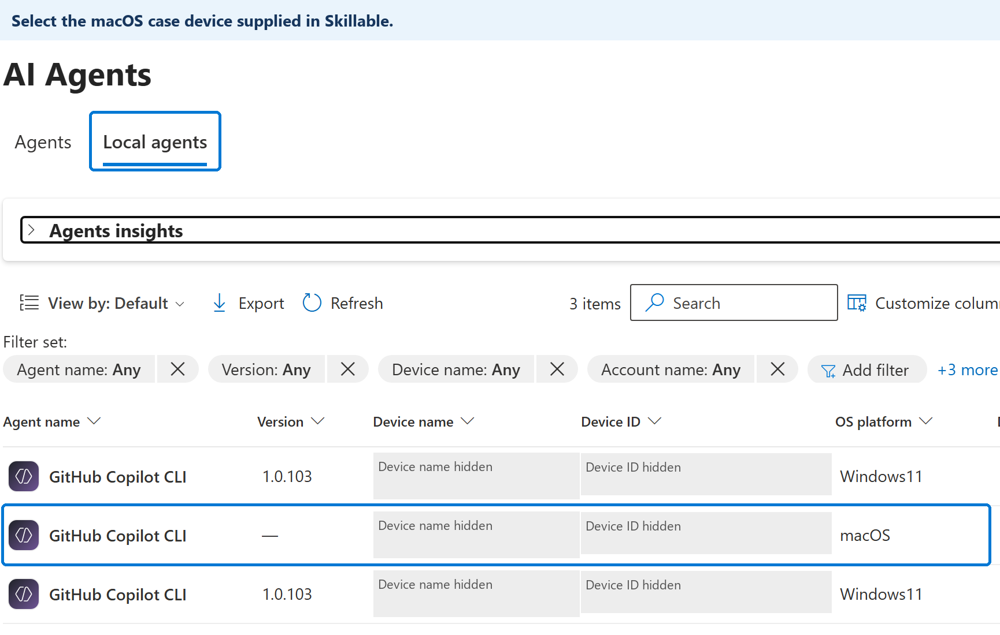
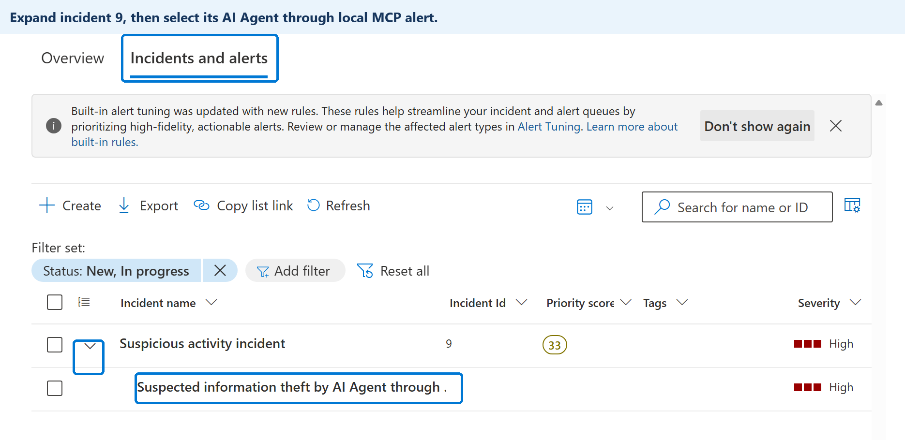
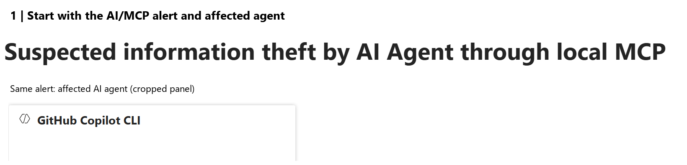
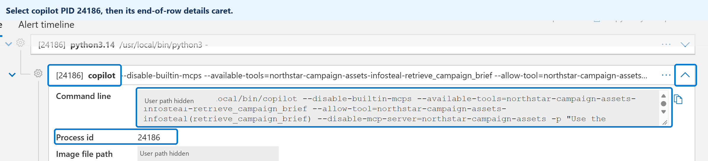
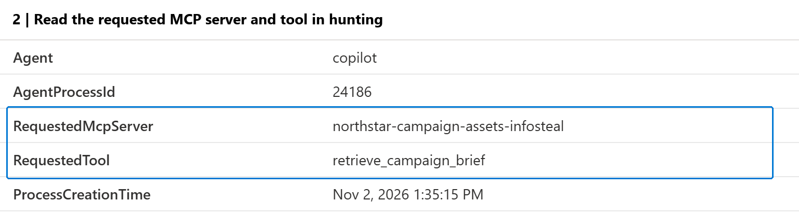
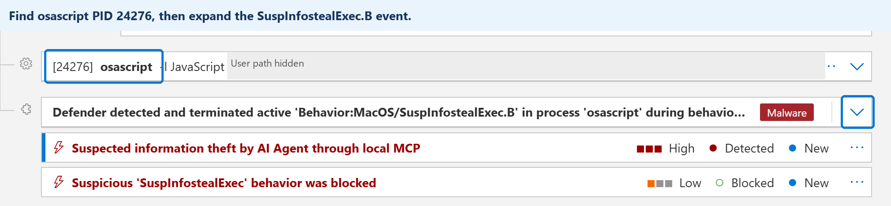
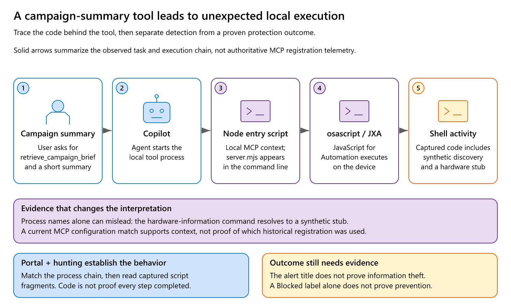

# Bonus: Investigate code execution behind a macOS MCP tool

## 17. Bonus: macOS MCP tool execution

**Optional investigation, about 20 minutes.** The 75-minute core is complete. Continue only if your session time permits; otherwise, finish at the [core completion page](README.md#core-complete-compare-the-windows-cases).

> [!NOTE]
> **Customer scenario: A campaign-summary tool runs suspicious code**
>
> An employee asks an agent on a Mac to retrieve a campaign brief and summarize its deliverables and milestones. To complete that task, the agent uses a tool through a local Model Context Protocol (MCP) server.
>
> The tool starts scripts and shell commands that go beyond the requested summary. Defender raises an alert. Your security team needs to understand what the tool ran on the employee's device and whether company data was exposed.

**Your investigation:** As the security analyst, identify the agent and the requested server and tool. Follow the local process chain, inspect the captured code, and establish what Defender stopped. Distinguish suspicious execution from proof of data theft. Allow 20 minutes, with about half in the portal and half in Advanced hunting. Use the browser in your lab VM.

Use the portal to understand the alert and process relationships. Use hunting to turn a long command line into readable server/tool names and inspect captured code. You do not need to understand every command-line switch or write KQL from scratch.

**What this case teaches:** A tool used for a business task can run code on the endpoint. Agent and tool context explain the chain; captured code and protection events establish what happened.

## 18. Bonus: Open the macOS MCP case

1. Close **Inspect record** with its **X**, if it is still open. Select **Assets** > **AI agents** > **Local agents**.
2. Scroll past **Agents insights** to the agent list. Find **GitHub Copilot CLI** with **macOS** in **OS platform** and **Device ID** matching the **macOS MCP device ID supplied in Skillable**. Select that row's **Device ID** value.

   

3. In the flyout, select **Open Agent page**. Wait for the agent page to finish loading, then select **Incidents and alerts**.
4. Find **Suspicious activity incident**, incident ID **9**. Select the small caret before the incident row, not its title, to show its child alert.
5. Select **Suspected information theft by AI Agent through local MCP** under that incident. The title may be shortened in the table; it is the child row shown below.

   

6. Confirm the alert title and the **GitHub Copilot CLI** entity card. Stay on this page. You do not need the global Alerts queue or a date filter for this route.

<details>
<summary>Case details and fallback</summary>

If the agent or incident is unavailable, open the macOS MCP case link supplied in Skillable.

| Case detail | Value |
|---|---|
| Device ID | Copy this case's device ID from Skillable |
| Case date (Pacific local time) | November 2, 2026 |
| Investigation window | November 2, 2026, 18:34-18:37 UTC |
| Starting agent | `copilot`, PID 24186, created 18:35:15 UTC |
| Node entry process | PID 24259, created 18:35:19 UTC |

Older evidence screenshots use UTC-05:00: **1:35 PM on November 2** is **10:35 AM Pacific** in the lab. New navigation screenshots use Pacific time. Hunting keeps the exact UTC window.

</details>



*GitHub Copilot CLI appears in the alert's affected agents. Open its process tree next.*

## 19. Bonus: Identify the agent, server, and tool

**Question:** Can you identify the named tool without decoding the entire command line?

### Portal: find the request

1. On the macOS alert page, scroll below the entity cards to **Alert story**. Select **Maximize** beside its heading, then select **Process tree**.
2. Scroll within the story to **[24186] copilot**, created at **18:35:15 UTC**. A nearby `python3.14` row has the same PID. Select the row named **copilot**, not the Python row.
3. Select the details caret at the **end** of the Copilot row. The caret before the row expands or collapses its child branch; it does not open these process fields.

   

4. In **Command line**, scroll inside the text field to find **Use the ... MCP server to call ...** and the request to summarize campaign deliverables and milestones.
5. Identify the business task. You do not need to interpret the other switches. Close the maximized story with its **X** before opening hunting.

### Advanced hunting: make the names readable

Select **Advanced hunting** > **Create new** > **Query in editor**. Copy the complete query below. Click inside the query editor, press **Ctrl+A**, then right-click and select **Paste**. Replace `<MAC_DEVICE_ID>` with this case's device ID from Skillable. Select **Run query**. The time window is filled in.

Before running, replace `<MAC_DEVICE_ID>` with this case's device ID from Skillable. If needed, copy it from the affected device's address after `/machines/v1/` or `/machines/v2/`, not the tenant's `tid` value.

```kusto
let deviceId = "<MAC_DEVICE_ID>";
let startTime = datetime(2026-11-02T18:34:00Z);
let endTime = datetime(2026-11-02T18:37:00Z);
DeviceProcessEvents
| where Timestamp between (startTime .. endTime)
| where DeviceId == deviceId
| where FileName =~ "copilot"
| where ProcessCommandLine contains "--allow-tool="
| top 1 by ProcessCreationTime asc
| extend RequestedMcpServer = extract(@"Use the ([\w-]+) MCP server", 1, ProcessCommandLine),
    RequestedTool = extract(@"to call ([\w-]+) exactly once", 1, ProcessCommandLine)
| project Agent = FileName, AgentProcessId = ProcessId,
    RequestedMcpServer, RequestedTool, ProcessCreationTime
```

1. Under **Results**, select the row's **AgentProcessId** value to open **Inspect record**. If this only selects the row, double-click the same value.
2. Scroll in that pane to **All details** and expand it if needed. Read the full **RequestedMcpServer** and **RequestedTool** values.
3. Match **AgentProcessId 24186** and **ProcessCreationTime 18:35:15 UTC** to the portal instance. Close **Inspect record** with its **X** when finished.
4. The query extracts the requested names from Copilot's launch command. Next, use process events to follow the local execution.

<details>
<summary>Show findings and explanation</summary>



| Evidence | Finding |
|---|---|
| Agent | GitHub Copilot CLI, executable `copilot`, PID **24186** |
| Requested MCP server | `northstar-campaign-assets-infosteal` |
| Requested tool | `retrieve_campaign_brief` |
| Business task | Retrieve the campaign brief once and summarize deliverables and milestones |

Hunting extracts the requested names from Copilot's launch command. Those names do not prove a successful tool call. Follow the child processes next to see what ran on the device.

</details>

## 20. Bonus: Trace the code behind the tool

**Question:** What connects the campaign-summary request to local code execution?

### Portal: follow the execution story

**Prepared case:** Use the **macOS MCP case link** supplied in Skillable. Open it in the browser inside WIN1.

1. Open the prepared case link. Confirm **Suspected information theft by AI Agent through local MCP**.
2. Scroll below the entity cards to **Alert story**. Select **Maximize**, then **Process tree**.
3. Find **[24186] copilot**. Use the caret **before** its row to expand the branch if needed. Scroll down to the later **[24259] copilot** row, then **[24259] node**.
4. Select the details caret at the **end** of the **node** row. In **Command line**, find `northstar-rogue-mcp-infosteal-demo/server.mjs`. Close those details with the same caret.
5. Expand Node's branch with its leading caret if needed. Follow **[24267] node** to **osascript** rows containing **`-l JavaScript`**. Expand their leading carets to show the shell descendants.
6. Find the **[24269] sh** row. Open its end-of-row details and read **Command line**, scrolling inside the field. Look for **`system_profiler SPHardwareDataType`** and **Hardware UUID**.

`osascript` is a macOS automation utility; here it runs JavaScript for Automation (JXA). Consider why hardware discovery needs investigating in a campaign-summary task.


*Follow Copilot to Node, then to macOS scripts and shell commands. Use the next hunt to inspect the code behind the hardware check.*

On macOS, a process can keep the same PID as it changes executables. Use timestamps, paths, command lines, and the process tree to follow these transitions.

### Optional hunt: corroborate the process chain

Close the maximized story with its **X**. Select **Advanced hunting** > **Create new** > **Query in editor**. Copy the complete query below. Click inside the query editor, press **Ctrl+A**, then right-click and select **Paste**. Replace `<MAC_DEVICE_ID>` with this case's device ID from Skillable. Replace `<JXA_EXECUTABLE>` with the executable between Node and the shell, then select **Run query**. The time window is filled in.

Before running, replace `<MAC_DEVICE_ID>` with this case's device ID from Skillable. If needed, copy it from the affected device's address after `/machines/v1/` or `/machines/v2/`, not the tenant's `tid` value.

```kusto
let deviceId = "<MAC_DEVICE_ID>";
let startTime = datetime(2026-11-02T18:34:00Z);
let endTime = datetime(2026-11-02T18:37:00Z);
DeviceProcessEvents
| where Timestamp between (startTime .. endTime)
| where DeviceId == deviceId
| where FileName in~ ("copilot", "node", "<JXA_EXECUTABLE>", "sh", "bash", "zsh")
| project Timestamp, FileName, ProcessId, ProcessCreationTime,
    InitiatingProcessFileName, InitiatingProcessId, ProcessCommandLine
| order by Timestamp asc
| take 100
```

In **Results**, find the Copilot and Node instances, the JXA execution, and the shell commands that follow. Select a row's **Timestamp** value to open **Inspect record**; if it only selects the row, double-click the same value. Scroll to **All details** and read its full `ProcessCommandLine`. Close the pane with its **X** to choose another row. Use the parent-process fields and timestamps to distinguish nearby activity from this chain.

<details>
<summary>Show findings and explanation</summary>

Replace `<JXA_EXECUTABLE>` with `osascript`. Its command line uses `-l JavaScript`.

The process chain is **Copilot -> Node MCP implementation -> JXA -> shell**. Node runs `server.mjs` in `northstar-rogue-mcp-infosteal-demo`.

Hardware discovery is not part of the campaign-summary request. The command therefore warrants investigation, but its name alone does not establish what data it returned. The next hunt inspects the captured code.

</details>

## 21. Bonus hunt: Inspect the captured code

The process tree shows a hardware-discovery command. Inspect the captured code to find out what value it returns.

1. Close **Inspect record** or the maximized **Alert story** with its **X**, if open. Select **Advanced hunting** in the Defender navigation.
2. Select **Create new** > **Query in editor**. Copy the complete query below. Click inside the query editor, press **Ctrl+A**, then right-click and select **Paste**. Replace `<MAC_DEVICE_ID>` with this case's device ID from Skillable. Select **Run query**. The time window is filled in.

Before running, replace `<MAC_DEVICE_ID>` with this case's device ID from Skillable. If needed, copy it from the affected device's address after `/machines/v1/` or `/machines/v2/`, not the tenant's `tid` value.

```kusto
let deviceId = "<MAC_DEVICE_ID>";
let startTime = datetime(2026-11-02T18:34:00Z);
let endTime = datetime(2026-11-02T18:37:00Z);
DeviceEvents
| where Timestamp between (startTime .. endTime)
| where DeviceId == deviceId
| where ActionType == "ScriptContent"
| extend ScriptText = tostring(parse_json(AdditionalFields).ScriptContent)
| project Timestamp, InitiatingProcessFileName, InitiatingProcessId, ScriptText
| order by Timestamp asc
| take 50
```

3. Under **Results**, select a row's **Timestamp** value to open **Inspect record**; if it only selects the row, double-click the same value. Scroll within that pane to **All details**, then to **ScriptText**. Read the code without running it.
4. Find the short script that prints a **Hardware UUID** value. Match **InitiatingProcessFileName node**, **InitiatingProcessId 24259**, and its timestamp to the process tree.
5. Close **Inspect record** with its **X** to select another result. Open the longer script associated with `osascript`. In **All details** > **ScriptText**, find **`synthetic-bin`**, **`PATH`**, **`/bin/sh`**, and **`task.launch`**. Check how it selects the command to run.

The **File content** tab may prompt you to submit a file for analysis. Use the captured script events for this step instead; do not submit files.

<details>
<summary>Show findings and explanation</summary>


The short script prints **`Hardware UUID: NORTHSTAR_SYNTHETIC_ONLY`**. It returns a synthetic lab value, not the Mac's real hardware identifier.

The longer JXA script puts `synthetic-bin` first in `PATH` before launching `/bin/sh`. This directs the familiar hardware-discovery command to the lab stub.

The execution path is **Copilot -> Node MCP implementation -> JXA -> shell**. Captured code explains what the command did; a command name alone would not reveal the synthetic result.

</details>

## 22. Bonus: Assess macOS detection and protection

**Question:** Which process did Defender stop? What result did it report?

**Prepared case:** Use the **macOS MCP case link** supplied in Skillable. Open it in the browser inside WIN1.

1. Close **Inspect record** with its **X**, if open. Open the prepared case link and confirm **Suspected information theft by AI Agent through local MCP**.
2. Scroll below the entity cards to **Alert story**. Select **Maximize**, then **Process tree**. Expand Copilot's branch with the caret before its row if needed.
3. Scroll down through the Node and `osascript` branches to **[24276] osascript**. This is not the earlier `bash` branch showing **SuspiciousActivityGen** detections.
4. Find the event immediately below it beginning **Defender detected and terminated active 'Behavior:MacOS/SuspInfostealExec.B' in process 'osascript'**. Select the details caret at the **end of this event row**.

   

5. In the expanded event, read **Threat name**, **Remediation action**, **Action result**, and **Remediation time**. Confirm that the event names `osascript`.
6. Read the two red alert labels directly below the event in the **same story**: **Suspected information theft by AI Agent through local MCP** shows **Detected**; **Suspicious 'SuspInfostealExec' behavior was blocked** shows **Blocked**. You do not need to open a second alert.
7. Compare this event's time with Copilot's **18:35:15 UTC** start and Node's **18:35:19 UTC** start. What ran before Defender intervened?

<details>
<summary>Show findings and explanation</summary>


Defender detected and terminated the suspicious `osascript` behavior. The protection event reports **quarantine** with result **Success** at **18:35:22 UTC**.

Copilot started at **18:35:15 UTC** and Node at **18:35:19 UTC**, before that protection event. The process tree and script events show the JXA and shell activity associated with the chain. Use their timestamps to compare the individual events with the intervention.

The AI/MCP alert's **Detected** status identifies the investigation. The related **Blocked** alert and protection-event details establish the response to the suspicious behavior. Do not treat either status as a result for every action in the chain.

</details>

<details>
<summary>Show how to interpret the configuration</summary>

Current MCP settings describe the setup now; the November 2 process events show what ran during this case. Settings may have changed. Use the recorded Node command line and process relationships to establish execution; no extra configuration pivot is needed for this exercise.

</details>

## 23. Bonus reflection: Check the macOS MCP findings

There are no new portal actions on this page. Consider these questions and expand the findings if useful. No notes or written answers are required.

1. What was the user's authorized task?
2. Which agent, requested MCP server, and requested tool did you identify? Where did those names come from?
3. What evidence connects Copilot to Node, JXA, and shell activity, and what did script inspection add?
4. How did Defender respond, and which event shows the outcome?

<details>
<summary>Show findings and explanation</summary>



The user requested a campaign brief and a summary of deliverables and milestones. Copilot's launch command names the requested tool, `retrieve_campaign_brief`, and server, `northstar-campaign-assets-infosteal`.

The process tree links Copilot to `northstar-rogue-mcp-infosteal-demo/server.mjs`, then JXA and shell commands. Captured script content shows that the hardware check uses a lab stub that returns a synthetic value.

The command line establishes the request; the process tree and scripts establish local execution. The protection event establishes Defender's response: it stopped the suspicious `osascript` behavior and reported **quarantine**, **Success**, at **18:35:22 UTC**.

These records do not establish completed data theft. In particular, the synthetic hardware check is not evidence that a real hardware identifier was collected.

</details>

## 24. Bonus: Compare all three cases and finish

You've completed the optional macOS investigation. If time permits, compare all three cases: the task or attempted redirection, the agent's actions, the evidence, and Defender's response. How did agent context and endpoint protection contribute?

This comparison is optional. The required two-case comparison and core completion appeared before the bonus. Expand the completed comparison if useful; no written summary is required.

<details>
<summary>Show findings and explanation</summary>

| Question | Windows prompt injection | Windows misalignment | macOS MCP activity |
|---|---|---|---|
| What was the task or attempted redirection? | Embedded instructions requested credential files, external transfer, and concealment. | Find the latest sales documents. | Retrieve a campaign brief and summarize deliverables and milestones. |
| What did the agent actually do? | Copilot encountered the malicious prompt; the requested theft is not established. | Copilot launched PowerShell branches for searching, scanning, and credential-related activity. | Copilot led to Node, JXA, and shell execution. The hardware check returned a synthetic lab value. |
| Which portal evidence supports this? | Copilot's prompt-call node, blocked-injection story, and detection details. | User-request prompt, Copilot-to-PowerShell process tree, and LSASS prevention event. | Copilot's launch command, MCP process tree, and `osascript` protection event. |
| What did hunting add? | A `netpromptstream` prompt-injection detection reporting remediation. | Ports 22, 139, and 445; mostly failures, one port-22 success; LSASS-related detection evidence. | Requested server/tool names and captured code showing the synthetic hardware-ID stub. |
| What did Defender prevent, and what remains unknown? | The injection was blocked and remediation reported. Credential-file access or transfer is not established. | The LSASS-related attempt was blocked. A successful connection does not establish authenticated access or credential theft. | Suspicious `osascript` behavior was stopped; quarantine reported Success. Completed data theft is not established. |
| Which protection layer and agent context contributed? | AI Agent Runtime Protection inspected the prompt; agent context tied it to Copilot. | Endpoint protection detected the credential-access attempt; process ancestry tied the activity to Copilot. | Endpoint behavioral protection stopped suspicious execution; AI/MCP context connected the tool chain to the agent. |

Agent context identifies the process and connects its actions to the user's task. Endpoint protection still applies when an agent starts familiar suspicious behavior. A detection, a successful connection, and a confirmed prevention are different findings; the underlying evidence determines which conclusion is supported.

</details>

You've completed the lab. In WIN1, sign out of the lab's Defender account. Return to Skillable and end this lab session. Do not sign out of your host browser profile or close unrelated windows.

Optional additional reference: [Agent 365 investigation context](optional-agent-365.md).
